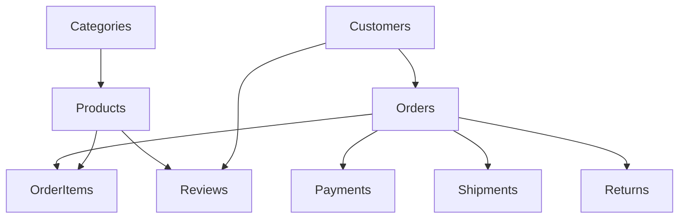

# Synthetic Interconnected Dataset Generation Engine

The iCoded Generation Engine is built on a **hybrid generation paradigm**:
1. **AI / Schema Planning Layer**: Derives business entities, referential integrity rules, primary-foreign key relationships, and indexes.
2. **Deterministic Volume Generator**: Generates high-volume parent-child entities with valid ObjectId references.
3. **Faker.js Layer**: Populates realistic names, addresses, descriptions, statuses, and timestamps.
4. **Data Quality Injection Engine**: Configurably introduces realistic business anomalies.
5. **Streaming Batch Insertion**: Uses MongoDB `insertMany` with unordered batches of 1,000 for maximum throughput without memory exhaustion.

---

## 🎯 Referential Integrity Model
Records are generated in topological order to ensure that all foreign references point to existing parents:

### Relational Mapping Rules:
- Primary keys are always `_id: new ObjectId()`.
- Foreign keys store matching parent `ObjectId`s.
- Cardinality constraints (1:1, 1:N, N:M via join collections like `order_items`) are strictly enforced.

---

## 🔍 Data-Quality Anomalies Injected
Configurable from 0% to 25%:
1. **Missing Values**: Random nullification of optional fields (phone numbers, middle names, delivery notes).
2. **Duplicate Submissions**: Simulates client-side retry events or duplicate webhooks.
3. **Outliers**: Extreme order totals or account balances (10x to 100x variance).
4. **Status Inconsistencies**: Returned items with delivered order status for edge-case query challenges.
5. **Date Skew**: Transactions logged across multi-year date ranges to test date aggregations.
